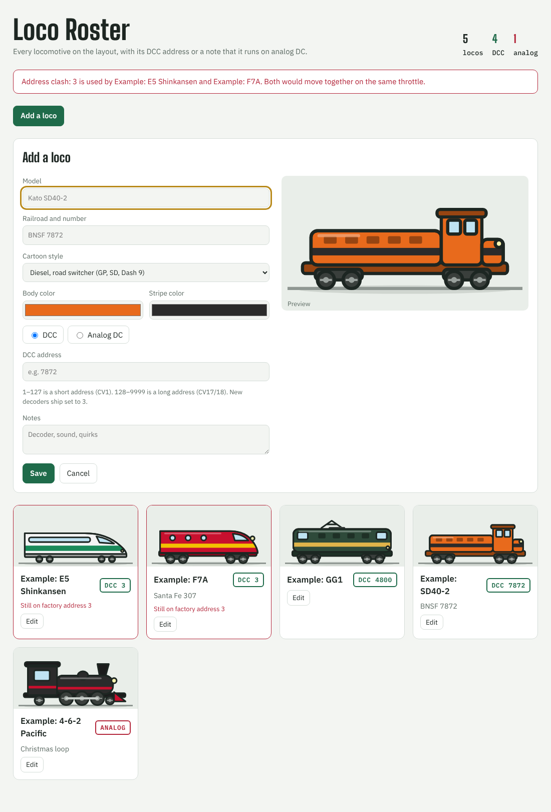

# Train Control

> This software was **developed with AI** (Claude, by Anthropic) and has only been tested on one layout. **Use it at your own risk.** It comes with no warranty of any kind. Licensed under GPL-3.0.

A loco roster for a model railroad, served as a web page on your network. Every locomotive gets a cartoon drawing in its own colors, with its DCC address on a plate, or an **ANALOG** plate for locos without a decoder.

It also catches two common DCC mix-ups:

- **Address clashes.** Two locos on the same address move together on one throttle. The page shows a warning naming both.
- **Factory address 3.** New decoders ship set to 3, so a loco still on 3 probably hasn't been programmed yet.

Any browser on the network sees the same roster, and changes show up on every open page right away.



Track control (running trains and throwing turnouts through JMRI and the Digitrax Zephyr) is planned for a later version.

## Run it with Docker

```
docker run -d --name train-control --restart unless-stopped -p 8070:8070 -v train-control-data:/data ghcr.io/jsttylr/train-control:main
```

Then open `http://<server address>:8070/`. There's also a `docker-compose.yml`.

On **Unraid**, add the template from `https://raw.githubusercontent.com/jsttylr/train-control/main/unraid/train-control.xml`. The roster is kept in `/mnt/user/appdata/train-control`.

The image is tagged `main` for the newest build. `latest` appears once a release is published.

## Run it on a computer

Download the build for your computer from the latest release (or the newest build's artifacts) and run it. It opens the roster in your browser. The roster file is kept in a `data` folder next to where you run it.

## Settings

| Setting | Environment variable | Default |
|---|---|---|
| Data folder | `TRAIN_CONTROL_DATA` | `data` (`/data` in Docker) |
| Address and port | `TRAIN_CONTROL_LISTEN` | `0.0.0.0:8070` |
| Don't open a browser | `TRAIN_CONTROL_NO_BROWSER` | off (on in Docker) |

There's no password, so anyone on your network can edit the roster. Don't expose port 8070 to the internet.

## The roster file

The roster is one readable file, `locos.json`, in the data folder. Back it up by copying it.

The same data is available at `/api/locos` (GET to list, POST to add, PUT `/api/locos/<id>` to change, DELETE to remove), for scripts or a future track-control add-on.
